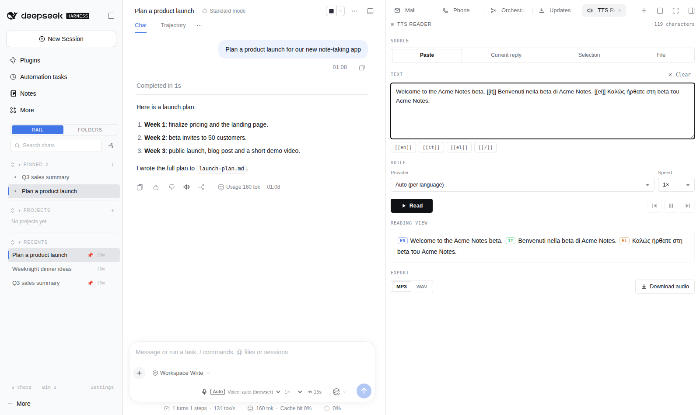

# dsh-voice

[](https://www.npmjs.com/package/@lucagiftzek/dsh-voice)

Read-aloud and dictation for DSH with 23 TTS and STT providers, per-language routing and word highlighting.

```bash
dsh plugin --profile web add dsh-better-sidebar   # the tab host, skip if installed
dsh plugin --profile web add @lucagiftzek/dsh-voice
# or from GitHub: dsh plugin --profile web add github:lucagiftzek/dsh-voice
# restart dsh web, then pick your speech providers in Settings, Voice
```



<sub>Screenshot from a demo DSH instance with sample data.</sub>

Read-aloud, dictation and language-aware speech for the DeepSeek Harness (DSH) web UI.

- A speaker on every finished assistant reply (and a `{ }` button that reads the code blocks).
- A microphone in the composer, with an optional polish pass that fixes punctuation without translating.
- **Several speech providers at once**, configured in Settings > Voice, each with a Test button.
- **Per-language routing**: English, Italian, Greek (and any language you add) each get their own provider, model, voice and speed.
- **In-text language markers** to switch language mid-text.

- **Language detection** per sentence, with a DSH model for the unsure ones, and a language badge while reading.
- **Highlighting** of the sentence and the word being read, and opt-in **auto-read** of new replies.

- A **TTS Reader** sidebar tab, push-to-talk **dictation** at the composer cursor, and **keyboard shortcuts**.

Status: 2.0.0. 23 provider types, EU vendors first; see [CHANGELOG.md](CHANGELOG.md). Runs on DSH 0.2.x (tested on 0.2.1) and DSH 0.1.5.

## Install

Install from npm: `dsh plugin --profile web add @lucagiftzek/dsh-voice`, or from GitHub: `dsh plugin --profile web add github:lucagiftzek/dsh-voice`.

```sh
dsh plugin --profile web add @lucagiftzek/dsh-voice
# or from GitHub: dsh plugin --profile web add github:lucagiftzek/dsh-voice
```

The package declares `dsh.bundle`, so `dsh plugin add` lists it in the profile bundles; restart `dsh web` to load the host half. `lib/` is committed, so no build step is needed. From a checkout instead: `git clone https://github.com/lucagiftzek/dsh-voice`, then `dsh plugin --profile web add link:$PWD/dsh-voice`. Then open Settings > Voice, add a provider and press Test.

## Providers

Settings > Voice lists providers in three groups, **EU first**, then **Others**, then **Self-hosted**, each with a residency badge (EU, EU region available, outside the EU, self-hosted, on device) and a timing badge (word timings, or estimated). "Add provider" lists every type with a one-line description and a docs link. Several instances of one type are normal (a local server plus a relayed one, two Azure regions). Keys never reach the browser, and a Test button on every row speaks a short phrase and transcribes it back (a speech-to-text-only provider borrows the spoken sample from another provider).

"Word timings" means the provider returns when each word is spoken, so the word highlight is exact; otherwise the highlight is estimated from the audio length (sentence highlight always works). A provider without a language in its list never receives that language through automatic routing. Status marks: *(planned)* has no public API documentation yet, *(unverified)* or *(partly verified)* means some request shapes could not be confirmed against vendor documentation on the date given under "Verification" in `docs/PROVIDERS.md`.

<!-- providers:begin -->

**EU first**

| Provider | TTS | STT | Word timings | Data residency | Price note | Docs |
|---|---|---|---|---|---|---|
| `mistral` Mistral | yes | yes | estimated | EU | TTS about $13 per 1M characters; STT $0.0035 to $0.008 per minute | [docs](https://docs.mistral.ai/studio-api/audio/text_to_speech) |
| `speechmatics` Speechmatics (partly verified) | yes | yes | estimated | EU region available | STT from about $0.24 per hour | [docs](https://docs.speechmatics.com/speech-to-text/batch/quickstart) |
| `gladia` Gladia (partly verified) | no | yes | n/a | Depends on the endpoint | check the vendor pricing page | [docs](https://docs.gladia.io/api-reference/v2/pre-recorded/init) |
| `acapela` Acapela Cloud (partly verified) | yes | no | word | Depends on the endpoint | quote on request | [docs](https://acapela-cloud.com/docs_api/) |
| `readspeaker` ReadSpeaker speechCloud (partly verified) | yes | no | estimated | Depends on the endpoint | credit plans via sales | [docs](https://www.readspeaker.com/solutions/speech-production/readspeaker-speechcloud-api/) |

**Others**

| Provider | TTS | STT | Word timings | Data residency | Price note | Docs |
|---|---|---|---|---|---|---|
| `elevenlabs` ElevenLabs | yes | yes | word (from characters) | EU region available | credits; flash v2.5 bills 0.5 credit per character | [docs](https://elevenlabs.io/docs/api-reference/text-to-speech/convert-with-timestamps) |
| `azure` Azure AI Speech (partly verified) | yes | yes | word | EU regions selectable | TTS about $15 per 1M characters; STT about $1 per hour real time | [docs](https://learn.microsoft.com/en-us/azure/ai-services/speech-service/rest-text-to-speech) |
| `google` Google Cloud Speech (partly verified) | yes | yes | word | EU regions selectable | check the vendor pricing page (Neural2 and Chirp 3 HD differ) | [docs](https://docs.cloud.google.com/text-to-speech/docs/reference/rest) |
| `amazon` Amazon Polly and Transcribe (partly verified) | yes | yes | word | EU regions selectable | Polly neural about $16 per 1M characters; Transcribe per second | [docs](https://docs.aws.amazon.com/polly/latest/dg/what-is.html) |
| `openai` OpenAI | yes | yes | estimated | Outside the EU | per character (TTS) and per minute (STT), see the pricing page | [docs](https://developers.openai.com/api/docs/guides/text-to-speech) |
| `openai-compatible` OpenAI-compatible (partly verified) | per preset | per preset | Kokoro-FastAPI captions, else estimated | Depends on the endpoint | depends on the server (free when self-hosted) | [docs](https://platform.openai.com/docs/api-reference/audio) |
| `fish` Fish Audio (partly verified) | yes | yes | estimated | Outside the EU | check the vendor pricing page | [docs](https://docs.fish.audio/api-reference/endpoint/openapi-v1/text-to-speech) |
| `cartesia` Cartesia (partly verified) | yes | yes | word | Outside the EU | check the vendor pricing page | [docs](https://docs.cartesia.ai/api-reference/tts/bytes) |
| `deepgram` Deepgram | yes | yes | estimated | EU region available | STT about $0.46 per hour (nova-3); TTS per 1M characters | [docs](https://developers.deepgram.com/reference/text-to-speech/speak-request) |
| `assemblyai` AssemblyAI | no | yes | n/a | EU region available | STT per hour, see the pricing page | [docs](https://www.assemblyai.com/docs/pre-recorded-audio/api-reference/transcripts/submit) |
| `mimo` Xiaomi MiMo (partly verified) | yes | yes | estimated | Depends on the endpoint | Token Plan subscription | [docs](https://mimo.mi.com/docs/en-US/updates/model) |
| `dashscope` Alibaba DashScope | yes | yes | estimated | Outside the EU | per character | [docs](https://www.alibabacloud.com/help/en/model-studio/qwen-tts) |

**Self-hosted and local**

| Provider | TTS | STT | Word timings | Data residency | Price note | Docs |
|---|---|---|---|---|---|---|
| `elevenlabs-compatible` Self-hosted (ElevenLabs-compatible) | yes | yes | word (from characters) | Self-hosted | free (your server) | [docs](https://elevenlabs.io/docs/api-reference/text-to-speech/convert) |
| `tzekos-native` Kokoro (native /api/tts) | yes | no | estimated | Self-hosted | free (your server) | [docs](https://github.com/hexgrad/kokoro) |
| `lfm3` Liquid LFM3 Audio (local) | yes | yes | estimated | Self-hosted | free (local) | [docs](https://huggingface.co/LiquidAI) |
| `piper` Piper (self-hosted) | yes | no | estimated | Self-hosted | free (local) | [docs](https://github.com/OHF-Voice/piper1-gpl/blob/main/docs/API_HTTP.md) |
| `xtts` Coqui XTTS-v2 (self-hosted) (partly verified) | yes | no | estimated | Self-hosted | free (local, non-commercial licence) | [docs](https://github.com/daswer123/xtts-api-server) |
| `browser` Browser voice (Web Speech) | yes | no | word | On device | free | [docs](https://developer.mozilla.org/docs/Web/API/Web_Speech_API) |

<!-- providers:end -->

Providers are not picked up from the environment unless they are the 1.x engines (Mistral, MiMo, a local TTS server, Kokoro server, LFM3, ElevenLabs, Groq, Alibaba, which keep working with no settings at all). Every other provider is added in Settings > Voice (credential pointer, region, preset), then chosen per language.

## Setup per provider

Add the provider in Settings > Voice, give it a credential pointer (see below) and, where the vendor has regions, an EU region. Then pick it in the language table, or use it as a fallback. The notes below are generated from the adapters.

<!-- setup:begin -->

#### Mistral (`mistral`)

Voxtral text-to-speech and transcription from a French company; api.eu.mistral.ai keeps inference in the EU.

Residency: EU company; api.eu.mistral.ai keeps inference in EU/EFTA data centres TTS languages: en. STT languages: en fr. Presets: Mistral, Mistral EU. Credential: the API key (`env:MISTRAL_API_KEY`). Use the `mistral-eu` preset for EU-only inference. Greek has no preset voice: pick `voxtral-mini-tts-3-0` and a cloned or Italian-capable voice only after listening.

Verification: Request shapes carried from the 1.x adapter, which ran against the live API; the EU base URL and model names follow the Mistral docs read for the v2 spec on 2026-10-31. Voxtral TTS 3 voices per language were checked by ear, not by API.

#### Speechmatics (`speechmatics`)

High accuracy transcription with Greek, Italian and English on a pinned EU1 batch endpoint; free English TTS preview.

Residency: UK company; the EU1 endpoint (eu1.asr.api.speechmatics.com) processes batch audio in Europe. The TTS preview host does not state a region. TTS languages: en. STT languages: el it en. Regions (EU first): **eu1**, **eu2**, us1, au1. Presets: Speechmatics EU1, Speechmatics EU2 (enterprise failover). Credential: the API key. Region `eu1` (default) or `eu2`; keep it on an EU region. Speech to text only through the batch API; the English TTS preview is optional.

Verification: Checked 2026-10-31 on docs.speechmatics.com (batch quickstart, input, output, synchronous, limits, authentication, regions, languages, TTS quickstart). Confirmed: POST /v2/jobs/ multipart (data_file + config JSON) with a Bearer key, status polling on GET /v2/jobs/{id} (running, done, rejected), GET /v2/jobs/{id}/transcript?format=json-v2 with word start_time/end_time, hosts eu1 (all customers) and eu2 (enterprise failover), el/it/en in the language list, accepted containers (wav mp3 aac ogg amr m4a mp4 flac; webm is converted to wav), TTS preview endpoint preview.tts.speechmatics.com/generate/<voice> with four English voices and wav 16 kHz output. Unverified: DELETE /v2/jobs/{id} cleanup and the job list used by health() (only named in the API reference menu), the preview TTS data region and its stability (preview, pricing announced separately). Realtime WebSocket (wss://eu.rt.speechmatics.com/v2) is not implemented: the protocol reference could not be read, so it is left out.

#### Gladia (`gladia`)

French speech to text (Solaria models) with automatic language detection and word timings for Greek, Italian and English.

Residency: French company; the docs name no regional endpoint or processing location, so EU processing is not confirmed. Enterprise zero retention disables upload. STT languages: el it en. Presets: Gladia. Credential: the API key (sent as `x-gladia-key`). Greek is transcribed with `solaria-1`; the adapter picks it for you.

Verification: Checked 2026-10-31 on docs.gladia.io (OpenAPI for POST /v2/upload, POST /v2/pre-recorded, GET /v2/pre-recorded/{id}, authentication, language detection, supported languages and formats, data retention). Confirmed: x-gladia-key header, upload field audio, init body (audio_url, model, language_config.languages/code_switching), status values queued/processing/done/error, result.transcription.utterances[].words[] with word/start/end/confidence, models solaria-1/solaria-3/solaria-fusion, el/it/en supported (Greek on solaria-1 only), formats wav mp3 flac ogg opus m4a mp4 (webm is converted to wav). Unverified: batch regions (none documented, so no region setting and EU processing is unconfirmed), DELETE /v2/pre-recorded/{id} cleanup and the list call used by health(). Live WebSocket transcription is not implemented.

#### Acapela Cloud (`acapela`)

Acapela Cloud text to speech with Greek, Italian and English voices and word positions for highlighting.

Residency: French company; the public API reference does not say where Acapela Cloud hosts or processes requests, so EU processing is not confirmed. TTS languages: el it en. Presets: Acapela Cloud. Credential: one string `email:password` of the Acapela Cloud account (the adapter logs in and caches the token). Set `defaultVoice` to a voice of the account.

Verification: Checked 2026-10-31: https://www.acapela-group.com/solutions/acapela-cloud/ (product page, links the API), https://acapela-cloud.com/docs_api/ (public API reference, no login), https://acapela-cloud.com/docs_tags/ and https://www.acapela-group.com/voices/available-languages/ (Greek and Italian are offered). Confirmed: POST /api/login/ (email, password -> token), Authorization "Token <t>", GET /api/command/ parameters voice/text/output/type/speed/wordpos, output=events JSON with Word events (EventKind, Time, WordOffset, WordSize, Word), error bodies for credit and voice. Unverified: the exact JSON of GET /api/account/ voices (parser is tolerant), the POST variant of /api/command/, hosting region, per-voice language list (depends on the account), and credit cost of the separate events call. Credential format here: one string "email:password".

#### ReadSpeaker speechCloud (`readspeaker`)

ReadSpeaker speechCloud text to speech with Greek, Italian and English voices; word timings are not wired yet.

Residency: Swedish company (Uppsala), GDPR and ISO 27001 stated; the public material does not name the hosting region. TTS languages: el it en. Presets: ReadSpeaker speechCloud. Credential: the speechCloud API key. Greek and Italian voice names are only in the customer portal: set `defaultVoice` (and `langCodes` if your account uses other codes).

Verification: Checked 2026-10-31: the speechCloud product page (curl example for POST https://tts.readspeaker.com/a/eg/v2.0 with key, voice, lang, audioformat, audiobitrate, text), the public Product Specification PDF (SCAPI 4.19, streaming 1/0, 5,000 characters excluding whitespace, RSDS timing is MP3 48 kbit/s only and not for all voices) and https://www.readspeaker.com/languages-voices/ (Greek, female voice only, and Italian are TTS languages). Confirmed: endpoint, the key in the form body, the example fields, streaming semantics, the character limit. Unverified because they live in the customer portal: the language codes for Greek and Italian (el_gr and it_it are guesses, override with the langCodes option), voice names for Greek and Italian (set a default voice), parameter names for speed, pitch and volume (not sent), the voices-list call (static list), and the RSDS and timing JSON layouts, so word alignment is returned as null and the client estimates it.

#### ElevenLabs (`elevenlabs`)

Best Greek and Italian cloud voices, character-level word timings; EU residency endpoint on Enterprise.

Residency: EU data residency (api.eu.residency.elevenlabs.io) on Enterprise only, with a separate workspace and key TTS languages: any. STT languages: any. Presets: ElevenLabs, ElevenLabs EU residency. Credential: the API key (`env:ELEVENLABS_API_KEY`). Use the `elevenlabs-eu` preset only with an Enterprise EU-residency workspace and its own key.

Verification: Request shapes carried from the 1.x adapter (live use) and the with-timestamps reference read for the v2 spec on 2026-10-31. The EU residency host is documented but needs an Enterprise workspace, so it was not exercised.

#### Azure AI Speech (`azure`)

Microsoft neural voices (Greek Athina and Nestoras, many Italian) and fast transcription with word timestamps; EU regions.

Residency: Microsoft (US company) with EU regions: pick an EU region (West Europe, Sweden Central, Italy North and others) to keep processing there. Credential is the Speech resource key; the region is a separate setting. TTS languages: en el it de fr es pt nl sv pl ro bg. STT languages: en el it de fr es pt nl sv pl ro bg. Regions (EU first): **westeurope**, **northeurope**, **swedencentral**, **francecentral**, **germanywestcentral**, **italynorth**, **spaincentral**, **norwayeast**, **switzerlandnorth**, uksouth, eastus, eastus2, westus2, westus3, canadacentral, brazilsouth, australiaeast, japaneast, southeastasia, centralindia. Presets: Azure AI Speech (West Europe), Azure AI Speech (Sweden Central), Azure AI Speech (Italy North). Credential: the Speech resource key; set the region of that resource (EU regions are listed first). Word timings use the TTS WebSocket (option `wordBoundary`); if it fails the read continues over REST.

Verification: Fetched 2026-10-31: Speech TTS REST reference (endpoint per region, headers Ocp-Apim-Subscription-Key / Authorization Bearer, Content-Type application/ssml+xml, X-Microsoft-OutputFormat, User-Agent, voices/list response fields, status codes 400/401/415/429/502/503), the STT short-audio REST page (60 s limit, wav pcm 16 kHz and ogg opus only), the fast transcription page and REST reference (multipart audio + definition {locales}, api-version 2025-10-15, wav/mp3/ogg/webm accepted, phrases[].words with offsetMilliseconds and durationMilliseconds), and the language support page (el-GR AthinaNeural and NestorasNeural, it-IT Elsa, Isabella, Diego and others, STT el-GR and it-IT). STT uses fast transcription (accepts webm and ogg directly, word timestamps documented) instead of the short-audio REST API. The regional host https://{region}.api.cognitive.microsoft.com is taken from the issueToken and endpoint examples; not confirmed for transcriptions:transcribe on every region. WordBoundary word timings over the TTS WebSocket are UNVERIFIED against official docs: Microsoft documents the socket only through the Speech SDK. The message layout (speech.config, synthesis.context with audio.metadataOptions.wordBoundaryEnabled, ssml, audio, audio.metadata, turn.end) was read from the MIT licensed Speech SDK for JavaScript sources and the open source edge-tts client; it has not been run against the live service. Option wordBoundary (default on) turns it off; any socket failure falls back to REST with alignment null (the client estimates at sentence level). Credential: the Speech resource key. Region: instance region setting (EU regions first). Not verified: per-region voice availability, quota numbers.

#### Google Cloud Speech (`google`)

Google Cloud voices (Wavenet, Neural2, Chirp 3 HD) with Greek and Italian, and Speech-to-Text; EU endpoint, API key.

Residency: Google (US company). The eu-texttospeech and eu-speech endpoints keep data at rest and in use in Europe; the global endpoint does not. TTS languages: en el it de fr es pt nl. STT languages: en el it de fr es pt nl. Regions (EU first): **eu**, us, global. Presets: Google Cloud (EU endpoint), Google Cloud (global endpoint). Credential: a Cloud API key (or an OAuth bearer token starting `ya29.`). Region `eu` (default) uses the EU endpoints. Word timings need a non-Chirp voice (for example Neural2).

Verification: Fetched 2026-10-31: regional endpoints page (eu-texttospeech.googleapis.com, EU multi-region, data stays in Europe), the v1beta1 text:synthesize and v1 voices.list discovery documents (request fields input.text/ssml, voice.languageCode/name, audioConfig.audioEncoding/speakingRate, enableTimePointing SSML_MARK, response audioContent base64 and timepoints[markName,timeSeconds], voices[languageCodes,name,ssmlGender]), the SSML page (mark timepoints), the Chirp 3 HD page (SSML tag list without mark), the voice list (Greek el-GR Wavenet-B, Standard-B and Chirp3-HD; Italian Neural2, Wavenet, Standard, Chirp-HD, Chirp3-HD), the Speech-to-Text v1 discovery document (speech:recognize, RecognitionConfig, enableWordTimeOffsets, WordInfo startTime/endTime, WEBM_OPUS and OGG_OPUS need a sample rate of 8000, 12000, 16000, 24000 or 48000, MP3 only in v1p1beta1), the STT regional endpoint page (eu-speech.googleapis.com with v1 recognize) and the STT language table (el-GR and it-IT, default model). Re-checked 2026-10-31 (pre-merge review): the v1beta1 discovery document has enableTimePointing [SSML_MARK] and timepoints[{markName, timeSeconds}], and /v1beta1/text:synthesize exists on eu-texttospeech.googleapis.com (unauthenticated call answers 403 like /v1, not 404); Chirp 3 HD has no <mark> tag. Google warns that marks in rapid succession may drop events: a word whose mark is missing is not highlighted on its own (the previous word stays lit). Unverified: that v1beta1 timepoints are served by the EU endpoint for every voice, that the EU endpoint offers every Wavenet/Neural2 voice (the endpoints page only shows icons for Chirp and Gemini), the mp3 bitrate used for the duration estimate (32 kbps assumed), the sample rate of browser WebM clips (48000 is sent), and word offsets for Greek on the default model. Credential: an API key (X-Goog-Api-Key); a value starting with "Bearer " or "ya29." is sent as an OAuth bearer token. Word timings: SSML marks on Standard, Wavenet, Neural2, Polyglot, Studio and News voices only; Chirp 3 HD, Chirp HD and Journey return no timings (client estimates).

#### Amazon Polly and Transcribe (`amazon`)

Amazon Polly voices with word timings (Italian, no Greek) and Transcribe streaming speech to text; EU regions, SigV4.

Residency: Amazon (US company). Pick an EU region (Frankfurt, Ireland and others) to process there. Credential format: ACCESSKEYID:SECRET or ACCESSKEYID:SECRET:SESSIONTOKEN. Polly has no Greek voice. TTS languages: en it de fr es pt nl sv pl da. STT languages: en it el de fr es pt nl. Regions (EU first): **eu-central-1**, **eu-west-1**, **eu-west-2**, **eu-west-3**, **eu-north-1**, **eu-south-2**, **eu-central-2**, us-east-1, us-east-2, us-west-2, ca-central-1, ap-southeast-1, ap-northeast-1. Presets: Amazon Polly and Transcribe (Frankfurt), Amazon Polly and Transcribe (Ireland). Credential: one string `ACCESSKEYID:SECRET` (add `:SESSIONTOKEN` for temporary credentials), for an IAM user allowed `polly:SynthesizeSpeech`, `polly:DescribeVoices` and `transcribe:StartStreamTranscriptionWebSocket`. Pick an EU region. Polly has no Greek voice.

Verification: Fetched 2026-10-31: Polly SynthesizeSpeech API reference (JSON body Engine, LanguageCode, OutputFormat json|mp3|..., SpeechMarkTypes, Text, TextType, VoiceId; engines standard, neural, long-form, generative; 6000 character limit; LanguageCode list has no Greek), DescribeVoices (GET /v1/voices?Engine=&LanguageCode=, response Voices[Id,Name,Gender,LanguageCode,SupportedEngines]), the speech marks pages (json lines with time in ms, type, start and end in BYTES of the UTF-8 input, value; available for neural, long-form and standard, not generative), the Transcribe supported languages table (el-GR and it-IT streaming), the Transcribe WebSocket setup page (presigned URL on port 8443, query language-code, media-encoding, sample-rate, signed header host, event stream encoding with CRC32 prelude and message checksums, AudioEvent headers, TranscriptEvent and exception headers, empty AudioEvent ends the stream) and the AWS endpoint tables (Polly in eu-central-1, eu-west-1, eu-west-2, eu-west-3, eu-north-1, eu-south-2, eu-central-2; Transcribe streaming in eu-central-1, eu-west-1, eu-west-2, eu-central-2). STT uses the streaming WebSocket (batch Transcribe needs S3). Re-checked 2026-10-31 (pre-merge review) against the Transcribe API reference (Result, Alternative, Item pages): TranscriptEvent Results[IsPartial, LanguageCode, ResultId, Alternatives[Transcript, Items[Content, StartTime, EndTime, Type pronunciation|punctuation]]] and the event-stream headers match; el-GR is listed for streaming. Unverified: the identify-language and language-options query parameters used when no language is given, and whether audio sent faster than real time is accepted (chunks of 100 ms are sent with a short pause). Neural default voices per language come from the VoiceId list, not from a per language voice table. Word timings: a second SynthesizeSpeech call with OutputFormat json and SpeechMarkTypes word (billed again by Polly as characters); not available on the generative engine, where alignment is null. Byte offsets are converted to string offsets. Credential parse failure gives bad_key.

#### OpenAI (`openai`)

OpenAI speech: gpt-4o-mini-tts and tts-1 voices, whisper-1 word timings, gpt-transcribe. TTS models shut down 2027-01-06.

Residency: Default api.openai.com processes in the US. The EU host eu.api.openai.com stores and processes in the EEA and Switzerland, but needs OpenAI sales approval and Modified Abuse Monitoring or Zero Data Retention, and costs 10 percent more. TTS languages: any. STT languages: any. Presets: OpenAI, OpenAI EU (data residency, needs approval). Credential: the API key. The `openai-eu` preset needs an EU data-residency project with approval from OpenAI. The TTS models retire on 2027-01-06 and whisper-1 plus the gpt-4o transcribe family on 2027-02-26.

Verification: Fetched 2026-10-31: developers.openai.com text-to-speech guide (13 voices, tts-1 and tts-1-hd limited to 9, response formats, languages follow Whisper including Greek and Italian), speech-to-text guide (gpt-transcribe recommended, `languages` replaces `language` for it, response carries `languages: [{code}]`, whisper-1 gives word timestamps via verbose_json and timestamp_granularities[], 25 MB limit), deprecations page (tts-1, tts-1-hd, gpt-4o-mini-tts shut down 2027-01-06; whisper-1 and gpt-4o transcribe models 2027-02-26) and the your-data page (EU host eu.api.openai.com, regional storage and processing, MAM or ZDR required, sales eligibility, 10 percent uplift). Unverified: maximum input length of /audio/speech (4096 characters assumed), word timestamps for gpt-transcribe (treated as json only), speed range 0.25 to 4 (from memory of the API reference).

#### OpenAI-compatible (`openai-compatible`)

Any server with the OpenAI audio shape: /v1/audio/speech and /v1/audio/transcriptions (Groq, Kokoro-FastAPI, Speaches, LocalAI, OVHcloud).

Residency: Depends on the endpoint: self-hosted servers keep audio on your machine, OpenAI EU and OVHcloud are EU-processed, Groq is US only. STT languages: any. Presets: Groq (whisper), OpenAI, OpenAI EU (data residency, needs approval), Kokoro-FastAPI (self-hosted), Speaches / faster-whisper-server (self-hosted), LocalAI (self-hosted), openedai-speech (self-hosted, TTS), OVHcloud AI Endpoints (whisper). Credential: the key the server expects (leave empty and tick `keyless` for a local server). Presets fill in the base URL: Kokoro-FastAPI (word timings through its captioned speech route, no Greek), Speaches, LocalAI, openedai-speech, Groq (speech to text), OVHcloud AI Endpoints.

Verification: Checked 2026-10-31. Confirmed from the vendor docs: OpenAI audio request shapes and the EU data residency host eu.api.openai.com (developers.openai.com data-residency table); Kokoro-FastAPI README (default port 8880, /v1/audio/voices, response_format and speed, POST /dev/captioned_speech with base64 audio and timestamps [{word,start_time,end_time}], voice names whose first letter is the language, languages English US/GB, Spanish, French, Hindi, Italian, Japanese, Brazilian Portuguese, Mandarin; Greek is NOT supported); Speaches README and usage pages (OpenAI-compatible /v1/audio/speech and /v1/audio/transcriptions, Kokoro and Piper TTS, faster-whisper STT, default port 8000; its voice list route is marked TODO in its docs so the voice list falls back to options.voices); openedai-speech README (tts-1 via Piper, tts-1-hd via XTTS, port 8000, project marked obsolete by its author); LocalAI docs list GET /v1/audio/voices and /v1/audio/speech on port 8080; OVHcloud AI Endpoints catalogue lists whisper-large-v3 and whisper-large-v3-turbo as speech-to-text models behind the base URL https://oai.endpoints.kepler.ai.cloud.ovh.net/v1. Unverified: that OVHcloud serves /audio/transcriptions word timestamps, OVHcloud speech output (its nvr-tts models) over /audio/speech (preset has TTS off), the EU hosting location of OVHcloud inference (OVHcloud is an EU company, so the preset is marked eu), LocalAI and Speaches word timestamp support.

#### Fish Audio (`fish`)

Expressive cloud TTS with a large voice library and voice cloning, plus transcribe-1-pro speech to text with word timings.

Residency: No EU region is documented; audio goes to Fish Audio (company seat US, unverified). Treat as non-EU. TTS languages: en zh ja ko es fr de it pt ru ar tr tl nl pl. STT languages: en zh ja ko es fr de it pt ru ar tr tl nl pl. Presets: Fish Audio, Fish Audio (free dev model). Credential: the API key. A new account has no credit: use the free model `s2.1-pro-free`. Greek is not advertised by the vendor.

Verification: Fetched 2026-10-31 from docs.fish.audio: Text to Speech (POST /v1/tts, Bearer, `model` header, body fields, formats mp3/wav/opus/pcm, prosody.speed 0.5 to 2), Speech to Text (POST /v1/asr multipart, model header transcribe-1-pro, language hint, ignore_timestamps, segments [{text,start,end}], language_code, speaker markers in text), List Models (GET /model, items with _id, title, languages, tags), models overview (S2.1-Pro 83 languages without a list; S1 deprecated, retires 2026-12-31; transcribe-1 retires 2026-12-31), TTS guide (normalisation languages incl. Italian). Unverified: Greek support (not in any published list, so not advertised; override with the languages option), EU residency or an EU endpoint, company seat, TTS word timestamps (a with-timestamps route is mentioned but not documented, so alignment is none), maximum text length, STT language list.

#### Cartesia (`cartesia`)

Sonic 3.6 TTS in 44 languages incl. Greek and Italian, word timestamps over WebSocket, plus Ink Whisper batch STT.

Residency: US company. api.cartesia.ai routes each request to the closest endpoint; dedicated EU deployments (and zero data retention) are Enterprise only, by contract, and no public EU hostname is documented. TTS languages: en de es fr ja pt zh hi ko it nl pl ru sv tr tl bg ro ar cs el fi hr ms sk da ta uk hu no vi bn th he ka id te gu kn ml mr pa or ur. STT languages: en zh de es ru ko fr ja pt tr pl ca nl ar sv it id hi fi vi he uk el ms cs ro da hu ta no th ur hr bg lt la mi ml cy sk te fa lv bn sr az sl kn et mk br eu is hy ne mn bs kk sq sw gl mr pa si km sn yo so af oc ka be tg sd gu am yi lo uz fo ht ps tk nn mt sa lb my bo tl mg as tt ln ha ba jw su. Presets: Cartesia. Credential: the API key. Word timings use the TTS WebSocket (option `wordTimestamps`), otherwise plain audio.

Verification: Fetched 2026-10-31 from docs.cartesia.ai: llms.txt, the markdown of the bytes, websocket, voices list and batch STT references, the Sonic 3.6 page (44 languages incl. el, it, en; model ids sonic-3.6, sonic-3.5, sonic-3), the TTS endpoint comparison, authentication and regional endpoints pages. Confirmed: base https://api.cartesia.ai, headers X-API-Key (Authorization Bearer also accepted) and Cartesia-Version 2026-08-14, POST /tts/bytes, GET /voices (data, has_more, next_page), POST /stt multipart with model ink-whisper, wss /tts/websocket?cartesia_version=... with add_timestamps returning type "timestamps" messages carrying word_timestamps {words, start, end} and base64 "chunk" messages, ended by a "done" message. Re-checked 2026-10-31 (pre-merge review): the websocket reference language enum now lists the same 44 codes as the model page, el and it included. Residency: no public EU hostname (dedicated regional deployments are Enterprise only). Unverified live: word timestamps for Greek; the adapter falls back to /tts/bytes (no alignment) if the socket fails or returns no words. Not exercised live. Voice ids are sent as {id}.

#### Deepgram (`deepgram`)

Nova-3 STT with word timings (incl. Greek) and Aura-2 TTS in 7 languages (no Greek); EU endpoint available.

Residency: US company with an EU endpoint (api.eu.deepgram.com) that keeps processing in the EU for /v1/listen and /v1/speak (not Whisper); the default endpoint is global. TTS languages: en es de fr nl it ja. STT languages: af ar be bn bs bg ca zh hr cs da nl en et fi fr gl de el gu he hi hu id it ja kn ko lv lt mk ms mr no fa pl pt ro ru sr sk sl es sv tl ta te th tr uk vi xh zu. Presets: Deepgram (global), Deepgram EU endpoint. Credential: the API key. Use the EU preset for `api.eu.deepgram.com`. Aura voices have no Greek; Nova-3 transcribes Greek and Italian.

Verification: Fetched 2026-10-31 from developers.deepgram.com: llms.txt, the markdown of the Single Text Request (POST /v1/speak, JSON {text}, query model/encoding/container/sample_rate/speed, Authorization: Token KEY), Pre-Recorded Audio (POST /v1/listen, response results.channels[0].alternatives[0].words and channels[0].detected_language), Regional Endpoints (EU base api.eu.deepgram.com serves /v1/listen, /v2/listen, /v1/speak, /v2/speak, Voice Agent and /v1/read, Whisper models excluded), Models and Languages Overview (nova-3 lists Greek el, Italian it, English en) and the Aura voices and languages page (Aura-2 languages: en, es, de, fr, nl, it, ja; NO Greek). The voice list is static (documented Aura-2 names). A raw audio request body with its own Content-Type is shown in the docs cURL example for /v1/listen. Not exercised live; Aura speed is documented but "not yet supported in all languages". Word timings for TTS are not offered (alignment none).

#### AssemblyAI (`assemblyai`)

Speech-to-text only: Universal-3.5 Pro (18 languages) with Universal-2 fallback for Greek, word timings; EU endpoint.

Residency: US company with an EU endpoint (api.eu.assemblyai.com) that processes and stores audio and transcripts in the EU; account and usage data stay in the US. STT languages: en es fr de id it ja nl pl pt ru sv tr uk ca ar az bg bs zh cs da el et fi gl he hi hr hu ko mk ms no ro sk tl th ur vi af be cy fa hy is kk lt lv mi mr sl sw ta am as bn gu ha ka km kn lb ln lo ml mn mt my ne oc pa ps sd sn so sr te tg uz yo. Presets: AssemblyAI (US), AssemblyAI EU endpoint. Credential: the API key. Use the EU preset for `api.eu.assemblyai.com`. Greek is transcribed with Universal-2 only.

Verification: Fetched 2026-10-31 from assemblyai.com/docs: llms.txt, markdown of Upload a media file (POST /v2/upload, application/octet-stream, header authorization, answer upload_url), Transcribe audio and Get a transcript (audio_url, speech_models, language_code, language_detection, status queued/processing/completed/error, words [{text,start,end in ms,confidence}], audio_duration, language_code, language_confidence, error), Model selection (current ids universal-3-5-pro and universal-2; the old speech_model field is deprecated), Supported languages and the Universal-3.5 Pro page (18 languages: no Greek, Italian yes; Universal-2 99 languages incl. Greek, Italian, English) and Cloud Endpoints (EU base api.eu.assemblyai.com). The universal-2 list in this adapter covers only languages given by name in the docs accuracy groups that map to a two-letter code. Not exercised live. Polling interval is inst.options.pollMs (default 1500) and the total wait is capped by inst.options.maxWaitMs (default 180000).

#### Xiaomi MiMo (`mimo`)

Xiaomi MiMo V2.5 TTS (built-in, designed or cloned voices) and ASR on the Token Plan (English, Chinese).

Residency: Token Plan AMS cluster (Amsterdam host); residency terms unverified TTS languages: en zh. STT languages: en zh. Presets: MiMo Token Plan (AMS). Credential: the Token Plan key (`env:MIMO_TOKEN_PLAN_API_KEY`); the base URL may be `http://host:port` for a relay.

Verification: Carried from the 1.x adapter, which ran live. The vendor docs (mimo.mi.com/docs, a single-page app) confirm the model releases (mimo-v2.5-asr 2026-06-02, MiMo-V2.5-TTS series 2026-04-23) on the model updates page; no dedicated audio API reference page could be fetched, hence partial.

#### Alibaba DashScope (`dashscope`)

Alibaba Qwen3-TTS on the pay-as-you-go workspace (ten languages, no Greek). Legacy, off by default.

Residency: International region is Singapore TTS languages: en zh ja ko de fr ru pt es it. STT languages: any. Presets: DashScope (pay as you go). Legacy, off unless `legacy.engines` is on.

Verification: Carried from the 1.x adapter (live in 2026-09); legacy, off unless legacy.engines is on.

#### Self-hosted (ElevenLabs-compatible) (`elevenlabs-compatible`)

Any server speaking the ElevenLabs request shape (preset: Local TTS server, a loopback server with a native /api/tts route).

Residency: Self-hosted: data stays wherever the server runs TTS languages: any. STT languages: any. Presets: Local TTS server, Generic ElevenLabs-compatible server. Credential: the server key. The Local TTS server preset points at a loopback server (`http://127.0.0.1:8771`).

Verification: Verified against a self-hosted reference server (Kokoro and Whisper behind native and ElevenLabs-shaped routes). Other servers with this shape are untested.

#### Kokoro (native /api/tts) (`tzekos-native`)

A Kokoro-82M server with a native POST /api/tts call, for example behind a relay (CPU is enough).

Residency: Self-hosted: data stays wherever the server runs TTS languages: en. Presets: Kokoro server. Credential: the server key. Only `POST /api/tts` is ever called.

Verification: Verified against the reference Kokoro server and the relay contract (POST /api/tts only, no probes).

#### Liquid LFM3 Audio (local) (`lfm3`)

Liquid LFM3-Audio-2B behind a llama.cpp router: local TTS and STT, 18 languages including Greek and Italian.

Residency: Local model: audio never leaves the machine TTS languages: en it el fr de es pt nl da fi pl sv tr ar he ja ko zh. STT languages: en it el fr de es pt nl da fi pl sv tr ar he ja ko zh. Presets: LFM3 Audio (llama.cpp). No credential. Loopback llama.cpp router; shares the GPU, so it is only used as an explicit fallback.

Verification: Verified live on the reference install in 1.x (router /tts and /v1/audio/transcriptions).

#### Piper (self-hosted) (`piper`)

Fast local neural voices through the Piper HTTP server; many languages including Greek and Italian voices.

Residency: Runs on your own machine, nothing leaves it. TTS languages: . Presets: Piper HTTP server (local). No credential needed. Start the Piper HTTP server (`python3 -m piper.http_server`) and point the base URL at it (default port 5000).

Verification: Fetched 2026-10-31: piper1-gpl docs/API_HTTP.md and src/piper/http_server.py (routes GET /, GET /info, GET /voices, GET /all-voices, POST /synthesize; default port 5000). NOTE the brief assumed POST /, the real route is POST /synthesize. The voices catalogue (rhasspy/piper-voices voices.json) lists el_GR-joy-medium, el_GR-rapunzelina-low, el_GR-rapunzelina-medium and it_IT-paola-medium, it_IT-riccardo-x_low, it_IT-serena-medium, it_IT-serena-high. The server only serves voices downloaded to its data dir. Unverified: word alignment (the web page shows phoneme alignment for the last utterance via /info, shape not documented, so alignment is none), authentication (the server has none; a bearer is sent only if you put one in front).

#### Coqui XTTS-v2 (self-hosted) (`xtts`)

Self-hosted voice cloning in 17 languages including Italian (no Greek); needs a reference speaker clip. Non-commercial licence.

Residency: Runs on your own machine. Model licence is CPML (non-commercial) and Coqui, the company behind it, is defunct, so there is no vendor support. TTS languages: en es fr de it pt pl tr ru nl cs ar zh hu ko ja hi. Presets: xtts-api-server (local). No credential needed. Set `defaultVoice` to a speaker sample name the server knows. Non-commercial licence.

Verification: Fetched 2026-10-31: xtts-api-server README and server.py (POST /tts_to_audio/ {text, speaker_wav, language}, GET /speakers, GET /speakers_list, GET /languages, default port 8020) and the coqui/XTTS-v2 model card (17 languages: en es fr de it pt pl tr ru nl cs ar zh-cn ja hu ko hi; Greek is NOT supported; licence Coqui Public Model License, non-commercial; Coqui AI is defunct). Unverified: exact JSON shape of /speakers and /languages (parsed leniently), per-request character limit (set to a conservative 200), speed (the server only has a global setting, so no per-request speed). The server needs a speaker_wav name or path on every call: set a default voice.

#### Browser voice (Web Speech) (`browser`)

The browser's own Web Speech voices: free and instant, robotic; local OS voices stay on the device.

Residency: Local OS voices stay on the device; cloud voices belong to the browser vendor TTS languages: any. Presets: Browser voice. Nothing to set up. It is the last-resort fallback.

Verification: Web Speech API as documented on MDN; synthesised in the page.

<!-- setup:end -->

### Credentials

An instance stores a pointer, resolved at call time:

| Form | Meaning |
|---|---|
| `env:NAME` | an environment variable of the DSH web process |
| `file:/path#NAME` | a `NAME=value` line of a dotenv-style file |
| `file:/path` | the whole file |
| `dsh-ref:NAME` | `refs.NAME` in the DSH credential store |
| `a\|b` | the first pointer that resolves |
| a literal key typed in Settings | stored in the plugin's own `vault.json` (mode 0600), never in a settings file; shown as `__set__` |

With no settings at all, the instances are discovered from the same environment variables 1.x read (`MISTRAL_API_KEY`, `MIMO_TOKEN_PLAN_API_KEY` / `MIMO_TOKEN_PLAN_BASE_URL` or the MiMo credentials file, `TTS_API_KEY` with `DSH_VOICE_TTS_HOST/PORT`, `GREY_TTS_URL` / `GREY_TTS_API_KEY`, `DSH_VOICE_LFM3_HOST/PORT`, `ELEVENLABS_API_KEY`, `GROQ_API_KEY`, `ALIBABA_*`), so an existing install keeps working without a config edit.

## Routing

`perLanguage.<lang>.tts` and `.stt` hold `{provider, model, voice, speed, fallback[]}`. The shipped value for every language is `provider: auto`, which is the built-in 1.x chain: English goes to MiMo, then Mistral; Greek, Italian and the rest go to the local TTS server (for example Maya1 and Whisper); ElevenLabs stays selectable but out of automatic routing. "Apply recommended" in Settings fills in the EU-first recommendation per language (Mistral for English and Italian, ElevenLabs for Greek, with fallbacks) for you to review and save.

### Per-language defaults

The shipped value of every language is `auto` (the 1.x chain above), so an existing install behaves exactly as before. "Apply recommended" fills a row with the EU-first suggestion below; review it and Save. Nothing is applied for you.

| Language | Read aloud, recommended | Fallbacks | Dictation, recommended |
|---|---|---|---|
| English | Mistral `voxtral-mini-tts-3-0`, voice `gb_oliver_neutral` | MiMo, ElevenLabs, browser | Mistral transcribe, then MiMo, then a local server |
| Italian | Mistral `voxtral-mini-tts-3-0`, voice `voice_482` | ElevenLabs, LFM3, local server, browser | local faster-whisper, then Mistral |
| Greek | ElevenLabs `eleven_multilingual_v2` (exact word timings in Greek; Azure with `el-GR-AthinaNeural` is the other cloud choice) | LFM3, local server, browser | local faster-whisper, then ElevenLabs Scribe |
| any other | first enabled provider whose language list covers it | browser | first multilingual provider |

Greek has no preset voice at Mistral, Amazon Polly, Deepgram Aura or Kokoro (and AssemblyAI's best model and XTTS lack it), so check the language list a provider declares (shown under its row and in the table above) before choosing it.

Resolution for one segment: marker override, then the manual pick in the composer, then the language row, then the `*` row, then any enabled instance that covers the language, then the browser voice. Routing chooses by availability; a failure inside a segment never switches provider mid-sentence.

## Language markers

| Form | Meaning |
|---|---|
| `[[el]]` | Greek from here on (sticky) |
| `[[it]]...[[/]]` | Italian for the span, then back |
| `[[auto]]` | back to automatic detection |
| `[[el voice=x provider=y model=z speed=1.1]]`, `[[pause 600]]` | per-span options, a pause in ms |
| `<!--lang:el-->`, `<!--lang:/-->` | the same, invisible in rendered markdown |
| `\[[el]]` | literal text |

Markers inside code are ignored, anything else in double brackets (a wiki link) stays text, and every marker is removed before the text is spoken.

## Language detection

Explicit beats detected: a marked span is never re-detected. Unmarked text is split into sentences (the Greek question mark `;` ends a sentence, the ano teleia does not), then:

1. **Script**: a sentence mostly in Greek (or Cyrillic, Arabic, Hebrew, CJK) is that language.
2. **Words**: Latin-script sentences are scored on stopwords and cues (accents, `-zione`, elisions, `-ing`, contractions) for English and Italian, plus French, German and Spanish when they are enabled. Short sentences (under 4 words) and unsure scores follow their neighbours, so "OK." between Greek sentences stays Greek and an English technical word inside an Italian sentence stays Italian.
3. **Model** (`detection.mode: heuristic+model`, the default): sentences still under `detection.minConfidence`, and Greek sentences holding a run of Latin words, go to the DSH model chosen in Settings (default `mistral-small-latest`, fallback `deepseek-flash`) in ONE batched call per message through the host LLM runtime, within `detection.timeoutMs` (2.5 s). Answers are cached in memory by a hash of the normalised sentence (the text is not stored). On a host without the LLM runtime, on a timeout or an unusable answer, the heuristics stand; detection never delays a read beyond the timeout and never fails one.

The speaker shows the language being read as a small badge (EN, IT, EL), with how it was decided in the tooltip.

## Reading

- **Highlight** (`reading.highlight`: `word` default, `sentence`, `off`): the sentence being read is always lit, the word too when timings exist (requested with `/tts?alignment=1`): ElevenLabs character timings, Azure WordBoundary events, Amazon Polly speech marks, Google SSML mark timepoints, Kokoro-FastAPI captions, Cartesia and Acapela word timestamps (the timing badge on each provider row says which), the browser voice's word boundaries, or else a proportional estimate (letters per word plus pauses after commas and full stops, scaled to the real audio length). The highlight uses the CSS Custom Highlight API, so the chat DOM is never changed; it follows the media clock, so pause, resume, skipping and speed changes stay in sync. The sentence in view is scrolled to, unless you scrolled in the last 5 seconds; `prefers-reduced-motion` turns smooth scrolling off. The word highlight is underlined, not colour only.
- **Controls** while reading: stop, pause/resume, next sentence.
- **Auto-read** (`reading.autoRead`: `off` default, `new-replies`, `new-replies-when-dictated`): reads replies that finish while the chat is in view, never its history; queued behind a read in progress; typing in the composer stops it.
- **Queue** (`reading.queue`): a second click replaces the current read (`replace`, default) or waits (`append`).

## TTS Reader tab

A tab of dsh-better-sidebar (id `dsh-tts-reader:main`, title "TTS Reader", so a saved sidebar layout keeps it; it replaces the separate dsh-tts-reader package, which is now a stub that registers nothing). Text comes from typing or pasting, the current reply, the selection in the chat, or a `.txt`, `.md` or `.html` file opened from this computer (read in the browser, nothing is uploaded). Buttons insert `[[en]]`, `[[it]]`, `[[el]]` and `[[/]]` at the cursor (around the selection when there is one); with Voxtral TTS 3 a menu inserts its emotion, pace and sound tags, which no other engine receives. The provider, model, voice and speed apply to this read only. The reading view shows the text per language with a chip each and the same highlight as the chat. **Download audio** writes the whole text as one MP3, or as one WAV when the voices differ in format or the text has pauses (the browser voice cannot be exported). The sidebar is optional: without dsh-better-sidebar everything else loads.

## Dictation

Click the microphone to start and stop, or hold it and release to send (`dictation.mode: push-to-talk` makes holding the only way). While recording a level meter and a cancel button appear. The chip next to the mic picks the language (Auto, or one of the enabled languages, whose row of the language table chooses the transcription provider); in Auto it shows what was heard. The transcript is polished by the DSH model chosen in Settings (punctuation and casing only, never a translation; Mistral and a local model stay as fallbacks) and inserted at the composer cursor (`dictation.insert`: `caret`, `append`, `replace`).

## Keyboard shortcuts

| Action | Default |
|---|---|
| Read the last reply | `Alt+Shift+R` |
| Play / pause | `Alt+Shift+P` |
| Stop | `Alt+Shift+S` |
| Next / previous sentence | `Alt+Shift+.` / `Alt+Shift+,` |
| Faster / slower | `Alt+Shift+=` / `Alt+Shift+-` |
| Dictation (tap toggles, hold to talk) | `Alt+Shift+M` |
| Cycle the dictation language | `Alt+Shift+L` |

Change or clear them in Settings > Voice (`shortcuts.*`). Keys are matched by their physical position, so a Greek or Italian layout keeps them. The DSH composer uses Alt or Shift with the arrow keys, Enter combinations and Ctrl+O, and DSH owns bare Escape; the defaults avoid all of them. Every control is a labelled button, toggles report their state, and status lines are announced politely to screen readers.

## Settings

Settings > Voice edits everything through `GET/PATCH /api/voice/settings` (the read redacts secrets; the write needs a short-lived capability token, the harness session cookie and a same-origin request). Where the values live depends on the DSH line (`lib/dual-settings.js`, shared with the other plugins of the 0.2 migration): on 0.1.5 the namespace `dsh-voice` of DSH Settings; on 0.2.x this plugin's row in the profile configuration, through the exported `Config` whose top-level keys are all live, with a one-time import of an old `dsh-voice:` section; without a settings service, the plugin settings file (`$DSH_VOICE_DATA_DIR`, default `~/.config/dsh-voice/settings.json`). Keys typed in Settings never land in any of these: they go to `vault.json` (mode 0600) next to it. Behind a reverse proxy, add the public host name to `security.trustedHosts` (on 0.1.5: `dsh-voice: { security: { trustedHosts: [your.host] } }` in `~/.dsh/settings.yaml`).

A Settings write is also checked for where it sends a key: a cloud provider's base URL (and its WebSocket or TTS host option) must be `https` on a public host, so a stored credential cannot be pointed at an internal service or a host of the writer's choosing; self-hosted types (ElevenLabs-compatible, Kokoro, LFM3, Piper, XTTS, OpenAI-compatible) may use loopback and LAN addresses; a value that equals the current environment-configured one (a relay) is always accepted; and a stored key (`vault:<id>`) can only be used by its own provider.

## HTTP routes

Unchanged from 1.x: `GET /api/voice/config`, `GET /api/voice/quota`, `POST /api/voice/tts`, `POST /api/voice/stt`, `POST /api/voice/polish`. New: `GET /api/voice/session`, `GET|PATCH /api/voice/settings`, `POST /api/voice/test`, `GET /api/voice/voices`, `GET /api/voice/models`, `GET /api/voice/doctor` (read-only self-check, same gate as the settings read; probes only loopback and self-hosted engines with a 2 s GET), `POST /api/voice/detect` (segments with language, source and confidence; the model pass included), and `POST /api/voice/tts?alignment=1` (JSON with base64 audio and word timings where the provider has them).

The 1.x routes stay open to same-origin callers (other plugins such as a notes plugin call `/stt` and `/polish`) but refuse a browser request from another site (`Sec-Fetch-Site: cross-site` or a foreign `Origin`), so a third-party page cannot spend credits. Rate limits per minute (`security.rateLimit`): `ttsPerMin` 60, `sttPerMin` 30, `detectPerMin` 60, `polishPerMin` 30.

## Privacy

- **No audio is stored.** The host keeps nothing: audio and transcripts pass through memory only, temporary files made for conversion are deleted in a `finally`, and logs carry the route, provider, status, character count and duration, never text or audio. The only way audio leaves the page for disk is **Download audio** in the TTS Reader, which you trigger yourself (`privacy.storeAudio` and `privacy.logTranscripts` stay off).
- Language detection sends only the unsure sentences of a message to the DSH model chosen in Settings; its cache holds a hash, not the text.
- **Which providers leave the EU.** Each row shows its residency: the *EU* group (EU company, EU processing) and the *self-hosted* group keep data in the EU or on your machine; *EU region available* means a non-EU company with EU regions (Azure, Google, Amazon, ElevenLabs on its residency plan, OpenAI on its EU project): choose the EU region explicitly, the region is part of the instance and shown in the row; *outside the EU* (DashScope, Cartesia, Fish, and any provider left on its default US endpoint) receives the text or audio you send it; MiMo's Token Plan host is in Amsterdam but its residency terms are not published, so treat it as outside the EU. Chrome's live speech recognition (`dictation.liveInterim`, off by default) sends audio to Google.
- Keys typed in Settings are kept in the plugin's own 0600 `vault.json`, never in a settings file, and are shown as `__set__`.

## When something goes wrong

- Ask your agent to load the **`voice-doctor`** skill (bundled; see
  [docs/TROUBLESHOOTING.md](docs/TROUBLESHOOTING.md#start-here) if it is not listed). If it is not
  registered yet, copy it by hand:
  `P=$(node -p "require('path').dirname(require.resolve('dsh-voice/package.json',{paths:[(process.env.DSH_HOME||require('os').homedir()+'/.dsh')+'/profiles/web']}))")`
  then `mkdir -p "${DSH_HOME:-$HOME/.dsh}/skills" && cp -r "$P/skills/voice-doctor" "${DSH_HOME:-$HOME/.dsh}/skills/"`.
- Run the self-check: `GET /api/voice/doctor` (read-only, no secrets in the output).
- Every error carries a stable `code`: [docs/ERRORS.md](docs/ERRORS.md).

## Development

```
npm install          # esbuild and react for the build and the render test
npm run build        # src/client -> lib/client.js, verified before it is written
npm test             # node --test
npm run check        # bundle and provider docs up to date + tests
npm run docs         # regenerate the provider table, setup notes and docs/PROVIDERS.md
PRIVACY_TERMS="host.example,name" npm run privacy -- --all   # your private terms, home paths, IPs, key shapes, dashes
```

`lib/client.js` is generated: edit `src/client/` and rebuild. The host half uses Node built-ins only.

Kill switch: add `- id: voice` with `disabled: true` to the web profile's `cordis.patch.yml` and restart dsh-web.

Note: the unscoped name `dsh-voice` on npm belongs to another project; install from GitHub as above.


License: MIT (see [LICENSE](LICENSE)).

---

## More plugins by the same author

All of them are open source and run on DeepSeek Harness 0.2.x (several on 0.1.5 too).

| Plugin | What it does |
|:---|:---|
| [dsh-artifacts](https://github.com/lucagiftzek/dsh-artifacts) | An Artifacts tab that lists the files an agent produced and previews them in place, plus a template library agents can use and extend |
| [dsh-mail](https://github.com/lucagiftzek/dsh-mail) | Mail client and agent mail tools: IMAP, POP3, SMTP and OAuth2 accounts, scheduled and bulk sends with unsubscribe handling |
| [dsh-note-keeper](https://github.com/lucagiftzek/dsh-note-keeper) | Obsidian-compatible Markdown notes in the sidebar with search, graph, audio notes and transcription, OCR and client-side encryption |
| [dsh-phone](https://github.com/lucagiftzek/dsh-phone) | SMS and calls (Twilio, SIP via Asterisk) with call audio through your own server, live voicemail and Telegram |
| [dsh-voice](https://github.com/lucagiftzek/dsh-voice) (this one) | Read-aloud, dictation and language-aware speech with 23 TTS and STT providers, per-language routing and word highlighting |
| [dsh-orchestrator](https://github.com/lucagiftzek/dsh-orchestrator) | Agent swarm and task orchestration: an Orchestrate tab, `orch_*` tools, runners, provider cards and a machine API |
| [dsh-workspace-rail](https://github.com/lucagiftzek/dsh-workspace-rail) | A workspace-first sidebar rail: pinned chats, projects as folders, live Recents, search and unread markers |
| [DSH-Idle-Watchdog](https://github.com/lucagiftzek/DSH-Idle-Watchdog) | Idle-chat nudges and an authenticated HTTP API that posts a prompt into any chat |
| [dsh-plugin-updates](https://github.com/lucagiftzek/dsh-plugin-updates) | Update checker that only offers releases your running DSH core can load |
| [dsh-subagent-tiering](https://github.com/lucagiftzek/dsh-subagent-tiering) | Subagents default to a cheaper sibling of the parent model unless the agent names a route |
| [dsh-fs-reobserve](https://github.com/lucagiftzek/dsh-fs-reobserve) | Ends self-inflicted stale-file errors after an agent's own shell commands |
| [dsh-request-image-cap](https://github.com/lucagiftzek/dsh-request-image-cap) | Clamps every image sent to the model to a pixel cap, fixing many-image request errors |
| [dsh-seal](https://github.com/lucagiftzek/dsh-seal) | An encrypted channel in front of DSH: a Go reverse proxy plus a service worker that seal all DSH browser traffic |

Built by Luca Tzekos, who also makes [**Job Opportunities API**](https://jobopportunitiesapi.org): employer-direct job data with per-field provenance you can verify yourself, free to read and available as an API. If this plugin is useful to you, a star on this repo or a look at [jobopportunitiesapi.org](https://jobopportunitiesapi.org) is the best thanks.
